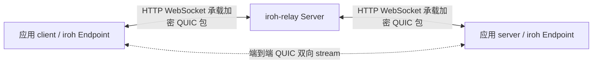

# iroh-relay + QUIC 分模块 Demo

参考 `/Users/gerald/test/rust/iroh` 的 **1.3.0** 源码，依赖固定为 crates.io 的 `iroh = 1.3.0` 和 `iroh-relay = 1.3.0`，无需引用该绝对路径。Rust 要求 1.91+。

## 先运行

在当前目录或父 workspace 运行：

```bash
cargo run -p iroh_relay_example -- demo
cargo run -p iroh_relay_example -- demo --message '你好，QUIC 🦀'
```

`demo` 在同一进程内启动三个独立的网络角色，relay 使用随机空闲端口。成功后会输出 `selected=true, relay=true`、原样回显和资源关闭提示。所有通信使用真实 socket，默认禁用 IP 直连，且不使用公共 relay / DNS 地址发现。

## 三个终端分别运行

按 **relay → server → client** 顺序启动。三个终端都进入 `iroh_relay_example` 目录；下面保留 `-p iroh_relay_example`，因此也可以从父 workspace 目录运行。在当前目录中，可以省略这段 `-p` 参数。

**地址格式：`--bind` 填 `IP:端口`，`--relay-url` 必须填带协议的完整 URL。** 本地 relay 使用 HTTP，所以要写 `http://127.0.0.1:3340`，不能只写 `127.0.0.1:3340`，也不要写成 `https://` 或 `quic://`。

### 1. 终端 1：启动 relay，并保持运行

```bash
cargo run -p iroh_relay_example -- relay --bind 127.0.0.1:3340
```

看到 `relay listening: Some(127.0.0.1:3340)` 后，再启动应用 server。`relay` 负责中继，`server` 负责 echo，需要同时运行。

### 2. 终端 2：启动应用 server，并保持运行

```bash
cargo run -p iroh_relay_example -- server --relay-url http://127.0.0.1:3340
```

server 会打印 `server EndpointId: ...`，以及一条已经填好 `--server` 公钥的完整 client 命令。**直接复制这条命令到终端 3 执行最方便。**

### 3. 终端 3：发送消息

也可以手动复制 EndpointId，替换下面变量中的中文内容：

```bash
SERVER_ID='替换为终端 2 打印的完整 EndpointId'
cargo run -p iroh_relay_example -- client \
  --relay-url http://127.0.0.1:3340 \
  --server "$SERVER_ID" \
  --message 'hello via relay'
```

成功时可以看到类似输出：

```text
path: Relay(http://127.0.0.1:3340/), selected=true, relay=true
echo: hello via relay (15 bytes)
```

server 每次启动生成新的身份，因此重启后要复制新的 EndpointId。client 一次发送一条消息然后退出，server 可以处理后续和并发连接。server / relay 使用 Ctrl+C 关闭。

### 参数速查与默认值

| 参数 | 用于哪个命令 | 格式 / 默认值 |
| --- | --- | --- |
| `--bind` | `relay` | 监听地址，默认 `127.0.0.1:3340`，不带 `http://` |
| `--relay-url` | `server`、`client` | 完整 URL，默认 `http://127.0.0.1:3340`；两端填写同一个 relay |
| `--server` | `client` | 必填，应用 server 打印的 EndpointId 公钥，不是 IP 或 URL |
| `--message` | `client`、`demo` | 默认 `你好，iroh QUIC!`；含空格的消息用引号包裹，最多 64 KiB |
| `--allow-direct` | `server`、`client` | 可选开关；不传时强制经过 relay |
| `--metrics` | `relay` | 可选监听地址，如 `127.0.0.1:9090`，默认不启用 |

本机使用默认端口时，终端 1 可以只运行 `cargo run -- relay`，终端 2 可以只运行 `cargo run -- server`；终端 3 仍需传 `--server`。

查看各命令帮助：

```bash
cargo run -p iroh_relay_example -- --help
cargo run -p iroh_relay_example -- relay --help
cargo run -p iroh_relay_example -- server --help
cargo run -p iroh_relay_example -- client --help
```

### 常见错误

| 错误 / 现象 | 处理方法 |
| --- | --- |
| `Failed to parse relay URL`，传入了 `127.0.0.1:3340` | 改成 `--relay-url http://127.0.0.1:3340` |
| 连接 relay 超时 | 先启动终端 1 的 `relay`；检查两端 URL、协议和端口是否与 relay 一致 |
| `Address already in use` | 检查是否已有 relay 占用端口；复用已有实例，或换 `--bind 127.0.0.1:3341`，并将两端 URL 都改为 `http://127.0.0.1:3341` |
| client 的 QUIC 请求超时 / 连接失败 | 确认应用 server 仍在运行，且 `--server` 使用其本次启动打印的公钥 |
| `--server` 解析失败 | 只复制完整 EndpointId，不要附带 `server EndpointId:`、尖括号或 URL |

## QUIC 和 relay 的关系



- **应用 QUIC 连接**：client 与 server 之间建立，使用公钥身份和端到端加密；`open_bi` / `accept_bi` 提供可靠有序字节流。
- **relay 传输**：两端各自连接 relay，relay 按目标 EndpointId 转发加密包，不终止应用 QUIC、不执行 echo，也不读取 echo 明文。本地示例的外层连接是 HTTP / WebSocket。
- **QAD（QUIC Address Discovery）**：relay 可选的独立 QUIC 服务，用于发现公网映射地址，帮助直连。它与应用数据 QUIC 是两项不同功能。本例 `ServerConfig.quic = None`，客户端 `RelayConfig.quic = None`，不启动 QAD。

关闭 IP transports 只禁用应用 QUIC 的 UDP 直连路径；两端仍通过 TCP 连接 relay，仍然运行端到端 QUIC。

## 示例模块

| 文件 | 职责与关键 API |
| --- | --- |
| `src/main.rs` | 初始化 tracing、解析命令、分发任务 |
| `src/cli.rs` | clap 子命令、relay 地址、EndpointId、直连选项 |
| `src/relay.rs` | `ServerConfig` + `server::RelayConfig`，启动 HTTP relay、可选 metrics、关闭与故障监控 |
| `src/endpoint.rs` | `presets::Minimal` + 自定义 `RelayMap`，共享网络设置，等待上线；默认 `clear_ip_transports()` |
| `src/server.rs` | `Router` 按 ALPN 分发到 `Echo`，打印身份，优雅关闭 |
| `src/protocol.rs` | ALPN `iroh-relay-demo/echo/1`；每条连接一个双向 stream；FIN 标记消息结束，最大 64 KiB |
| `src/client.rs` | `EndpointAddr(公钥 + relay URL)` 寻址；QUIC 连接、收发、字节比对、检查实际 relay 路径 |
| `src/demo.rs` | 编排三个角色；成功或普通错误时关闭 server 和 relay |
| `tests/relay_echo.rs` | 真实本地网络：空消息、UTF-8、64 KiB 边界、超长消息与错误 ALPN |

`endpoint.online()` 和 client 请求分别有 20 秒超时；服务端每条连接也有 20 秒处理期限，防止不发送 FIN 的请求无限占用任务。超时或协议错误会关闭对应连接。

## iroh-relay crate 功能导航

| 上游模块 / 类型 | 功能 | 在本例中的使用方式 |
| --- | --- | --- |
| `server` | HTTP/HTTPS relay、接入控制、速率限制、连接管理、可选指标服务 | 直接调用 `Server::spawn` |
| `client` | 到 relay 的连接、身份握手、数据包发送/接收 | 由 `iroh::Endpoint` 内部管理；应用无需手动封装 QUIC 包 |
| `protos::relay` | relay 线协议与控制/数据消息 | 由 iroh / relay 自动处理 |
| `RelayMap`、根级 `RelayConfig` | 客户端可使用的 relay 列表、URL、QAD 配置 | 只加入自建 relay，禁用 QAD |
| `quic`、`RelayQuicConfig` | QUIC 地址发现（QAD） | 本例解释但不启动；需要另配 TLS 与 UDP 监听 |
| `tls` | relay 连接的 TLS 验证配置 | 本地 HTTP 模式不需要自签证书或跳过证书检查 |
| `KeyCache`、`PingTracker` | 公钥缓存与 relay ping 跟踪 | 库内部使用 |

注意两个同名配置：`iroh_relay::server::RelayConfig` 是**服务端监听配置**，`iroh_relay::RelayConfig` 是**客户端 relay 地址配置**。

## 可选实验

允许直连：在 server 和 client 命令都增加 `--allow-direct`。两端保留默认 UDP transports，仍然通过 relay 寻址，并允许尝试升级到直连。一次短 echo 可能尚未升级，观察输出的 `path`，不要把启用选项当作已直连的证明。默认模式才能保证数据一定经过 relay。

启用 relay 指标：

```bash
cargo run -p iroh_relay_example -- relay --metrics 127.0.0.1:9090
curl http://127.0.0.1:9090/metrics
```

查看协议与连接日志：

```bash
RUST_LOG=info cargo run -p iroh_relay_example -- demo
```

跨机器实验时，relay 可绑定 `0.0.0.0:3340`，两端 `--relay-url` 使用带协议的实际可达地址，例如 `http://192.168.1.10:3340`（将 IP 替换为 relay 所在机器的地址），不能使用 `0.0.0.0` 或各自的 `127.0.0.1`。默认强制 relay 时只需要 relay 的 TCP 端口可达。

本例是本地教学配置：HTTP、默认 AllowAll、临时 endpoint 身份；公网部署应使用 HTTPS、按需求配置接入控制/限流及身份持久化。默认配置的具体行为以所固定的 1.3.0 API 为准。

## 验证

```bash
cargo fmt -p iroh_relay_example -- --check
cargo clippy -p iroh_relay_example --all-targets -- -D warnings
cargo test -p iroh_relay_example
cargo run -p iroh_relay_example -- demo
```

上游参考：

- 本地 `iroh/examples/echo.rs`：Router、ALPN、双向 stream 和关闭顺序。
- 本地 `iroh/src/endpoint.rs`：`clear_ip_transports()` 的 relay-only 测试。
- 本地 `iroh-relay/src/server.rs`、`relay_map.rs`：两种 RelayConfig 及 server 生命周期。
- [iroh 1.3.0 API](https://docs.rs/iroh/1.3.0/iroh/)
- [iroh-relay 1.3.0 API](https://docs.rs/iroh-relay/1.3.0/iroh_relay/)

参考目录的旧 `iroh/docs/local_relays.md` 存在历史配置写法，本例按 1.3.0 源码和 API 实现。
