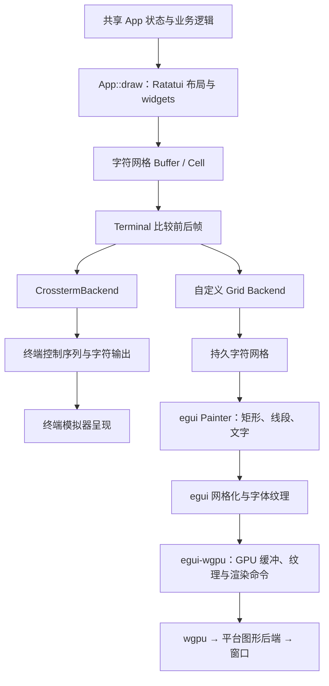
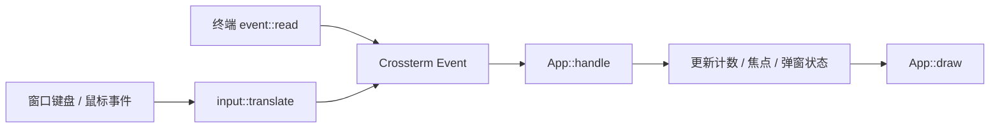

# Ratatui 与 wgpu 如何协作：从字符网格到 GUI

本文对应本项目的 Ratatui 0.30.2、eframe/egui 0.37 和 wgpu 30 实现。阅读入口是 [共享应用](../src/app.rs)、[网格后端](../src/gui/grid.rs) 和 [窗口驱动](../src/gui/mod.rs)。

核心思想是把**字符网格作为界面与显示设备之间的共同表示**。应用决定每一格显示什么，显示后端决定如何把这一格呈现出来。同一个按钮的状态、布局、边框和文字因此可以同时用于终端与窗口。

## 1. “把终端渲染到 GUI”具体指什么

本项目直接取得 Ratatui 生成的结构化字符网格，再绘制到原生窗口。窗口入口不启动 shell、PTY 或终端模拟器，也不解析 ANSI 输出，不需要截取终端图像。

终端版中的 `Terminal` 是 Ratatui 的绘制协调器。它可以包装 `CrosstermBackend`，也可以包装我们自己的 `Grid`；类型名中的 Terminal 并不要求绘制目标一定是操作系统终端。



这里有两个名称相似但职责不同的后端：

| 后端 | 输入 | 职责 |
| --- | --- | --- |
| Ratatui `Backend` | 字符单元格及其位置 | 把界面从 Ratatui 交给显示端 |
| wgpu 平台后端 | 图形资源和渲染命令 | 在 Metal、Vulkan、DX12 等图形 API 上执行 GPU 工作 |

`Grid` 实现第一个接口。egui-wgpu 使用第二层能力。wgpu 本身不理解中文、按钮、弹窗或者 Ratatui 的 `Cell`。

## 2. 一格包含的信息

Ratatui 的 `Buffer` 是二维单元格数组。对于宽度为 `W` 的网格，行优先索引为：

```text
index = row × W + column
```

单元格 `Cell` 保存符号字符串、前景色、背景色和修饰信息。符号可能是字母、中文、边框字符或者包含组合字符的字符串，不能简单当成一个字节或一个 Rust `char`。

例如按钮由若干单元格组成：

```text
┌──────────┐
│ 增加计数 │
└──────────┘
```

`App::draw` 使用 `Block` 和 `Paragraph` 写入这些单元格。选中按钮时，应用改变对应单元格的颜色。到了 `Grid` 这一层，按钮已经变成文字和样式；后端不再知道哪些格子属于按钮，也不负责执行按钮动作。

按钮的可点击矩形仍由 `App` 保存。这样，视觉布局和命中检测使用同一套网格坐标。

## 3. 算法一：完整布局、差分传递、持久保存

一次 `Terminal::draw` 大致有以下过程：

1. 应用为当前界面生成这一帧的 Buffer。
2. Ratatui 比较当前帧和上一帧，找出需要更新的单元格。
3. 调用 `Backend::draw`，传入 `(x, y, &Cell)` 的迭代器。
4. 后端应用变化；Ratatui 完成光标处理、flush 和帧缓冲切换。

“只传差异”不代表应用只画差异。当前 `App::draw` 仍然描述整个界面，由 Ratatui 负责比较前后结果。

终端可以持续保留此前显示的字符。GUI 后端也需要同样的记忆，因此 [Grid](../src/gui/grid.rs) 内部有一个持久 `Buffer`：

```text
for each (x, y, cell) in changes:
    persistent_grid[x, y] = clone(cell)
    repair_cells_covered_by_wide_symbol(x, y, cell)
```

如果只保存本次变化，窗口重绘时将缺少没有变化的按钮、边框和文字。持久网格让绘制器在任意一次重绘中都能取得完整画面。

本项目运行在同一个窗口事件线程中。`Grid::flush()` 不提交 GPU 命令，只返回成功；窗口驱动随后读取这个网格并调用画笔。GPU 提交由 eframe/egui-wgpu 完成。

Obelus 采用类似的后端边界，并通过通道传递更新、用帧结束消息协调窗口。本项目界面较小，没有引入跨线程通道。

## 4. 算法二：中文双宽字符的覆盖修复

字符的终端显示宽度与字符串长度不同。例如 `中` 通常占两列，虽然它是一个 Unicode 字符。

假设旧的一行是：

```text
列号       0      1      2      3
旧内容     a      b      c      d
新内容     中    覆盖格   文    覆盖格
```

Ratatui 的差分逻辑知道宽字符会覆盖后续列，因此不一定单独发送覆盖格。在真正的终端里，输出 `中` 会覆盖两列；自定义网格必须主动模拟这个行为，否则旧的 `b` 和 `d` 可能残留。

`Grid::draw` 使用 `unicode-width` 计算显示宽度 `span`，再清理后续覆盖格：

```text
span = max(1, display_width(cell.symbol))
grid[x, y] = cell

for covered_x in x + 1 .. min(x + span, columns):
    blank = clone(cell)
    blank.symbol = " "
    grid[covered_x, y] = blank
```

空白格继承原字符的样式，所以字符右半边具有相同背景色。边界截断和饱和加法避免网格末端的越界。

绘制文字时还有第二层处理：绘制器画完一个宽字符后按 `span` 跳到下一格，不把覆盖格再次当成独立字形绘制。

这里使用的是终端显示列宽，不是字体的实际像素宽度。窗口中的字体字形会放入对应的单格或双格区域，并裁剪到区域内。复杂 emoji、组合字符和不同终端宽度规则的兼容性仍需额外测试。

## 5. 算法三：网格坐标映射到窗口坐标

[窗口驱动](../src/gui/mod.rs) 当前固定每格为 `11 × 26` 个 egui 逻辑点，字体大小为 18 点。设内容区左上角为 `(ox, oy)`，格子尺寸为 `(cw, ch)`，则第 `(x, y)` 格的位置是：

```text
pixel_x = ox + x × cw
pixel_y = oy + y × ch
```

宽字符占据的文字区域是：

```text
glyph_rect.width  = cw × span
glyph_rect.height = ch
```

代码按该区域居中绘制文字，裁剪到该区域和窗口内容区的交集。各格的定位独立于前一个字形的字体 advance，因此字体回退不会改变后续单元格的位置。

窗口尺寸决定 Ratatui 可以使用的行列数：

```text
columns = clamp(floor(content_width  / cw), 1, 1000)
rows    = clamp(floor(content_height / ch), 1, 1000)
```

例如 `880 × 624` 逻辑点对应 `80 × 24` 个单元格。不能整除的余量显示为背景。

这些公式中的位置和尺寸统一使用 egui 逻辑坐标。eframe 负责逻辑坐标与显示器物理像素的换算；高 DPI 屏幕下无需再对鼠标坐标手动乘缩放系数。

窗口尺寸变化时，程序重建 `Grid` 的 Buffer，调用 `Terminal::resize` 更新 Ratatui 的内部缓冲，再重新布局。应用小于 52 列或 22 行时显示尺寸提示，避免控件被压到无法操作。

## 6. 算法四：背景与文字分两遍绘制

[paint::grid](../src/gui/paint.rs) 使用两遍遍历：

```text
第一遍：遍历所有格子，只画背景矩形。
第二遍：按显示宽度遍历符号，画文字或边框线段。
```

原因是绘制顺序会影响宽字符。如果逐格执行“画背景 → 画文字”，第 0 列刚画出的 `中` 会延伸到第 1 列；接着画第 1 列背景时，会遮住 `中` 的右半部分。

先完成所有背景，再画所有前景，宽字符就不会被后面的覆盖格背景挡住。

当前绘制器还完成这些样式转换：

| Ratatui 信息 | 窗口绘制方式 |
| --- | --- |
| RGB 色 | 转为 egui `Color32` |
| 16 色、256 色索引 | 经调色板或色立方公式转为 RGB |
| `Reset` | 使用前景/背景默认色 |
| `REVERSED` | 交换前景色和背景色 |
| `DIM` | 降低前景显示强度 |
| `BOLD` | 偏移 0.5 逻辑点再次绘制字形，近似加粗 |
| `UNDERLINED`、`CROSSED_OUT` | 额外绘制横线 |
| `HIDDEN` | 跳过前景绘制，保留背景 |

当前的粗体是近似效果，并未加载独立粗体字面。中文字体从系统路径或 `RATATUI_GUI_FONT` 加载，作为等宽和比例字体族的后备字体。

## 7. 算法五：边框字符转换成连续线段

如果直接用字体绘制 `─` 和 `│`，字体本身的宽高可能小于格子尺寸，两个相邻字符之间就会出现空隙。

当前 `border()` 将单线边框字符映射为“从格子中心向四个方向延伸”的连接信息：

| 字符 | 左 | 右 | 上 | 下 |
| --- | --- | --- | --- | --- |
| `─` | ✓ | ✓ | | |
| `│` | | | ✓ | ✓ |
| `┌` | | ✓ | | ✓ |
| `┘` | ✓ | | ✓ | |
| `┼` | ✓ | ✓ | ✓ | ✓ |

每个启用的方向都画一条从中心到格子边缘的线段。相邻格子的线段端点自然接合，按钮与弹窗的边框因此不依赖字体的边框字形尺寸。

Ratatui 仍决定边框的位置、符号和颜色，窗口绘制器只为这些符号选择更合适的几何表达。双线、粗线和圆角边框尚未加入此映射。

## 8. 从画笔命令到 GPU

应用调用 `Painter::rect_filled`、`text`、`line_segment` 后，egui 保存相应图形描述。后续流程由 eframe、egui 和 egui-wgpu 协作完成：

1. 字体系统布局文字，缓存字形并维护字体纹理。
2. egui 将图形描述转换为可绘制的三角形网格与裁剪信息。
3. egui-wgpu 上传需要更新的纹理、顶点和索引缓冲。
4. egui-wgpu 构建渲染命令，设置纹理、裁剪范围和绘制批次。
5. wgpu 执行命令，将结果绘制到窗口表面并呈现。

因此，CPU 负责应用逻辑、Ratatui 布局、差分和绘制命令生成；GPU 负责最终的图形绘制。不能把这套流程理解为“Ratatui 的布局算法在 GPU 上运行”。

项目在 `NativeOptions` 中选择 `Renderer::Wgpu`，并通过 Cargo features 显式启用 wgpu 平台后端。macOS 使用 Metal；其他平台选择可用的兼容后端。只有上层的 `wgpu` 功能而没有可用的平台后端时，可能编译成功却在创建图形实例时失败，因此测试会检查后端功能是否启用。

## 9. 输入的反向路径

画面由网格变成像素，鼠标则由逻辑像素反向映射为网格位置：

```text
column = floor((mouse_x - ox) / cw)
row    = floor((mouse_y - oy) / ch)
```

[input::translate](../src/gui/input.rs) 先检查位置是否落在内容区和有效网格内，再生成 Crossterm 的鼠标事件。点击右侧或底部不足一格的余量不会命中控件。



Crossterm 在窗口版里主要充当共享事件数据类型。窗口版不调用终端输入读取函数，也不进入 raw mode。

事件转换需要避免一次按键执行两次。例如 egui 可能同时提供 `Key(Space)` 和 `Text(" ")`，代码仅通过 Key 分支发送空格。普通可打印字符走 Text 分支，Enter、Tab、方向键等走 Key 分支。鼠标离开窗口时发送网格外的移动位置，使应用清除悬停状态。

每次窗口 UI 回调按以下次序工作：

```text
计算网格尺寸；必要时 resize
先执行 App::draw，刷新命中区域
依次处理输入事件：
    转换为共享事件
    App::handle
    再次 App::draw，刷新布局和命中区域
绘制最终持久网格
```

逐事件更新布局很重要：同一批事件可能先打开弹窗，再点击弹窗按钮。第二个事件必须使用弹窗的新命中区域，而不是上一帧主界面的区域。

## 10. 弹窗如何同时适用于两种前端

共享 `App::draw` 先画主界面，然后使用 Ratatui `Clear` 清除弹窗矩形内的单元格，再绘制弹窗的背景、边框、文字和按钮。

最终 Buffer 已包含弹窗覆盖后的结果。两种后端都只需要显示这个结果，无需各自实现一套弹窗组件。

模态行为由 `App::handle` 保证：弹窗打开后优先处理弹窗输入，不再激活背景按钮。**覆盖绘制负责视觉遮挡，输入路由负责阻止背景操作**，两者共同构成模态弹窗。

## 11. 性能与边界

设总网格大小为 `N = columns × rows`，改变的格子数量为 `K`：

| 阶段 | 当前实现的主要开销 |
| --- | --- |
| Ratatui 布局与缓冲比较 | 随界面和网格规模增长，比较通常为 O(N) |
| Grid 应用变化 | O(K + 宽字符覆盖格数量) |
| 持久网格空间 | O(N)，另外 Ratatui 维护前后帧缓冲 |
| GUI 背景与文字遍历 | 每次绘制 O(N) |

本项目实现了**网格更新的增量传递**，GUI 绘制仍遍历完整网格。没有实现只更新变化区域的 GPU 渲染，也没有为每格维护独立 GPU 缓存。窗口循环根据重绘请求工作，不主动启动持续定时刷新。

后续可以缓存行级文字布局、合并连续同色背景、减少逐格裁剪批次，或者把静态区域画到可复用纹理。应先测量 CPU 绘制命令生成和 GPU 提交开销，再决定优化方向。窗口呈现通常仍需要完整输出，简单“忽略未变化的格子”并不能保证上一帧的像素被保留。

当前应用以字符格为布局单位，已有以下边界：

- 按钮和文字保持网格排布，不会自动变成操作系统原生控件。
- GUI 后端保存了光标状态，但画笔尚未呈现光标；当前按钮示例没有文本编辑光标需求。
- 斜体、闪烁、输入法预编辑、文本选择、无障碍控件语义尚未实现。
- 格子尺寸固定；字号设置需要同时协调格子尺寸、重新布局与鼠标映射。
- 这套桥接面向使用 Ratatui 的应用，不能直接运行任意终端程序。支持任意程序还需要 PTY、控制序列解析和终端状态机等另一整套能力。

## 12. 代码阅读和验证

建议按这个顺序阅读：

1. [src/app.rs](../src/app.rs)：应用状态、布局和事件响应。
2. [src/main.rs](../src/main.rs)：终端版如何调用同一个应用。
3. [src/bin/gui.rs](../src/bin/gui.rs)：窗口入口。
4. [src/gui/mod.rs](../src/gui/mod.rs)：窗口创建、字体、网格尺寸、事件驱动。
5. [src/gui/grid.rs](../src/gui/grid.rs)：Backend 和双宽字符修复。
6. [src/gui/paint.rs](../src/gui/paint.rs)：坐标映射、两遍绘制和边框几何。
7. [src/gui/input.rs](../src/gui/input.rs)：输入事件与坐标转换。

```sh
# 对照运行相同 UI
cargo run
cargo run --features gui --bin gui

# 验证共享逻辑与窗口桥接
cargo test --all-features
cargo test --no-default-features
```

现有测试覆盖宽字符覆盖旧内容、鼠标网格坐标、空格事件去重、通过窗口事件操作共享按钮与确认弹窗、缩小后恢复窗口以及平台 GPU 后端配置。无 GPU 的绘制测试检查画笔输出和字符网格，并显式释放未上传的纹理变化；它不代替真实窗口的字体与视觉检查。
